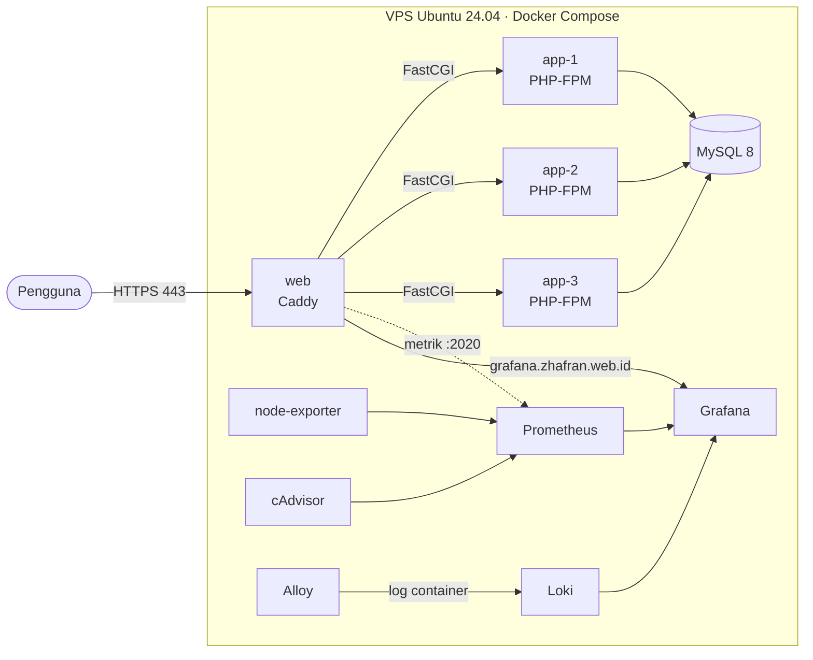
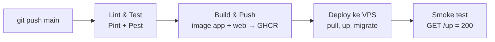

<div align="center">

# Njajan

**Aplikasi Laravel full-stack yang di-deploy ke cloud dengan Docker, HTTPS otomatis, CI/CD, monitoring, dan scaling.**

[](https://github.com/Rafifrn/CRUD-njajan/actions/workflows/ci-cd.yml)


[**Demo Aplikasi**](https://njajan.zhafran.web.id) ·
[**Pipeline**](https://github.com/Rafifrn/CRUD-njajan/actions) ·
[**Arsitektur**](#arsitektur) ·
[**Monitoring**](#monitoring-dan-log)

</div>

---

## Sorotan

| Fitur | Keterangan |
|---|---|
| **CI/CD penuh** | Setiap push ke `main` otomatis lint, test, build image, deploy, dan smoke test |
| **HTTPS otomatis** | Sertifikat Let's Encrypt diterbitkan dan diperpanjang oleh Caddy |
| **Scaling 3 replika** | Caddy membagi beban secara round robin. Load test: 3.155 request, 100% sukses |
| **Observability** | Prometheus, Loki, dan Grafana dengan dashboard 10 panel |
| **Keamanan berlapis** | Firewall dua lapis, hanya satu service yang membuka port, secret tidak masuk repo |
| **Satu Dockerfile** | Multi-stage: Node → Composer → PHP-FPM → Caddy |

## Daftar isi

[Arsitektur](#arsitektur) · [Teknologi](#teknologi) · [Menjalankan lokal](#menjalankan-secara-lokal) · [CI/CD](#pipeline-cicd) · [Deployment](#deployment) · [Monitoring](#monitoring-dan-log) · [Scaling](#scaling) · [Keamanan](#keamanan) · [Testing](#testing) · [Catatan teknis](#catatan-teknis) · [Struktur](#struktur-repository)

## Arsitektur



- **web**: Caddy 2. Menyajikan file statis, HTTPS otomatis, reverse proxy ke semua replika `app`, dan mengeluarkan metrik.
- **app**: PHP 8.4-FPM, 3 replika. Sesi dan cache memakai database, sehingga aman untuk banyak replika.
- **mysql**: MySQL 8.0, hanya dapat diakses dari jaringan internal Docker.
- **Monitoring**: berjalan di compose yang sama, tanpa port publik.

## Teknologi

| Lapisan | Teknologi |
|---|---|
| Aplikasi | Laravel 12, Livewire, Vite, Tailwind |
| Runtime | PHP 8.4-FPM, Caddy 2, MySQL 8.0 |
| Kontainer | Docker, Docker Compose, GitHub Container Registry (GHCR) |
| CI/CD | GitHub Actions, Pest, Pint |
| Monitoring | Prometheus, Grafana, Loki, Alloy, node-exporter, cAdvisor |
| Keamanan | UFW, firewall panel VPS, Let's Encrypt |

## Menjalankan secara lokal

```bash
git clone https://github.com/Rafifrn/CRUD-njajan.git && cd CRUD-njajan
cp .env.example .env
# isi DB_DATABASE, DB_USERNAME, DB_PASSWORD, MYSQL_ROOT_PASSWORD, GRAFANA_ADMIN_PASSWORD

docker compose build
docker compose run --rm --no-deps app php artisan key:generate --show   # salin hasilnya ke APP_KEY
docker compose up -d
docker compose exec app php artisan migrate --seed
```

| Layanan | Alamat |
|---|---|
| Aplikasi | http://localhost |
| Grafana | http://grafana.localhost (login `admin`) |

> Port 80 dan 443 harus kosong. Matikan Apache atau Nginx lokal bila perlu.

## Pipeline CI/CD

Berkas: [`.github/workflows/ci-cd.yml`](.github/workflows/ci-cd.yml). Setiap `push` ke `main` menjalankan tiga job berurutan, dan job berikutnya hanya jalan jika yang sebelumnya lolos.



| Job | Isi |
|---|---|
| **Lint & Test** | PHP 8.4, `composer install`, `pint --test`, `pest` (7 test) |
| **Build & Push Image** | Build image `app` dan `web`, push ke GHCR dengan tag SHA commit dan `latest` (dengan cache) |
| **Deploy ke VPS** | SCP `docker-compose.yml` dan `monitoring/`, lalu SSH: `docker compose pull`, `up -d` (image dipin ke SHA commit), `php artisan migrate --force`, bersihkan image lama |
| **Smoke test** | Memeriksa `https://njajan.zhafran.web.id/up` sampai berstatus 200 |

- Pull request ke `main` hanya menjalankan *Lint & Test*.
- Deploy memakai `environment: production`, jadi riwayatnya tercatat di GitHub.
- Image yang berjalan selalu dapat ditelusuri ke satu commit.

## Deployment

- **Server**: VPS Ubuntu 24.04 (2 vCPU, 4 GB RAM) dengan Docker dan Compose.
- **DNS**: A record `njajan` dan `grafana` pada `zhafran.web.id` mengarah ke VPS.
- **Konfigurasi**: `.env` produksi dibuat manual di server (`chmod 600`) dan tidak pernah masuk repository maupun pipeline.
- **HTTPS**: Caddy menerbitkan dan memperpanjang sertifikat Let's Encrypt secara otomatis.

## Monitoring dan log

Seluruh stack monitoring berjalan di `docker-compose.yml` tanpa port publik. Grafana hanya dapat dicapai lewat HTTPS di `grafana.zhafran.web.id`, dengan password acak dan pendaftaran mandiri dimatikan.

Dashboard **Njajan Monitoring** berisi 10 panel:

| Kelompok | Panel | Sumber |
|---|---|---|
| Server | CPU, RAM, disk VPS | node-exporter |
| Container | CPU dan memori per container | cAdvisor |
| Traffic | Request per detik, latensi p95, request per status code | Caddy |
| Log | Log aplikasi (PHP-FPM) dan log web (Caddy) | Loki + Alloy |

## Scaling

Service `app` berjalan dengan **3 replika** (`deploy.replicas: 3` di `docker-compose.yml`). Caddy menemukan semua replika lewat DNS Docker dan membagi request secara round robin. Jumlah replika tertulis di compose, sehingga tetap sama pada setiap deploy.

**Load test** (`hey`, 20 koneksi paralel, 30 detik):

| Metrik | Hasil |
|---|---|
| Total request | 3.155 |
| Throughput | 104,8 request/detik |
| Status code | 100% `200` |
| Latensi rata-rata | 190 ms |
| Latensi p50 / p95 / p99 | 177 ms / 297 ms / 357 ms |

**Pembagian beban per replika:**

| Replika | Request |
|---|---|
| app-1 | 1.056 |
| app-2 | 1.054 |
| app-3 | 1.055 |

Bebannya terbagi hampir sama rata, jadi round robin Caddy bekerja seperti yang diharapkan.

## Keamanan

| Aspek | Penerapan |
|---|---|
| **Firewall** | Dua lapis: firewall panel VPS dan UFW, keduanya hanya mengizinkan TCP 22, 80, 443 |
| **Permukaan serangan** | Hanya service `web` yang membuka port. MySQL, Prometheus, Loki, dan lainnya tanpa `ports:` (Docker melewati UFW, jadi aturan ini dijaga di compose) |
| **HTTPS** | Otomatis untuk aplikasi dan Grafana, plus header `X-Content-Type-Options`, `X-Frame-Options`, dan header `Server` dihapus |
| **Secret** | `.env` produksi hanya di server (`chmod 600`). Kredensial CI di GitHub Secrets (`VPS_HOST`, `VPS_USER`, `VPS_SSH_KEY`). `.env*` masuk `.gitignore` dan `.dockerignore` |
| **Least privilege** | Kunci SSH khusus deploy. VPS menarik image dengan token yang hanya punya izin `read:packages` |
| **Hardening aplikasi** | `APP_DEBUG=false`, password akun seeder diganti, Grafana memakai password acak |

## Testing

```bash
./vendor/bin/pest          # 7 test, 16 assertion
./vendor/bin/pint --test   # cek gaya kode
```

Test mencakup halaman login, login dengan nomor telepon, password salah, penambahan makanan oleh admin, dan penolakan akses non-admin ke dashboard admin. Keduanya juga dijalankan otomatis di CI.

## Catatan teknis

<details>
<summary><b>cAdvisor dan Docker 29</b></summary>

Docker 29 memakai penyimpanan image containerd, dan cAdvisor v0.49.1 gagal membaca container (error `failed to identify the read-write layer ID`, label `name` kosong). Memperbarui ke cAdvisor v0.55.1 memperbaikinya.
</details>

<details>
<summary><b>Versi PHP</b></summary>

`composer.lock` memakai Symfony 8.1 yang butuh PHP 8.4.1 ke atas, jadi image Docker dan CI memakai PHP 8.4.
</details>

<details>
<summary><b>Test dan Vite</b></summary>

Di CI tidak ada `public/build`, jadi test memanggil `withoutVite()` agar tidak mencari manifest Vite.
</details>

<details>
<summary><b>Migrasi saat deploy</b></summary>

Migrasi dijalankan otomatis (`migrate --force`) setelah container baru naik. Pada deploy pertama, halaman yang memakai sesi sempat error 500 sampai migrasi selesai karena tabel `sessions` belum ada.
</details>

## Struktur repository

```
.github/workflows/ci-cd.yml    pipeline CI/CD
Dockerfile                     image app dan web (multi-stage)
docker-compose.yml             seluruh stack (app, web, mysql, monitoring)
docker/caddy/Caddyfile         web server, HTTPS, load balancing, metrik
docker/php/                    opcache.ini dan entrypoint.sh
monitoring/                    Prometheus, Alloy, provisioning Grafana
tests/                         test Pest
.env.example                   contoh konfigurasi (tanpa secret)
```

---

<div align="center">

Dibuat oleh **Muhammad Rafi Zhafran** · Final Project Cloud Engineer · 2026

</div>
